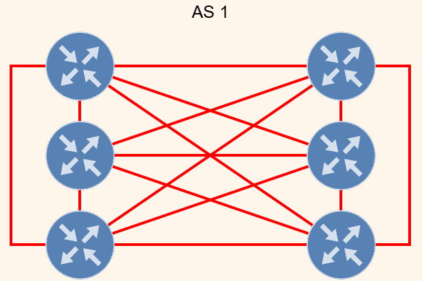
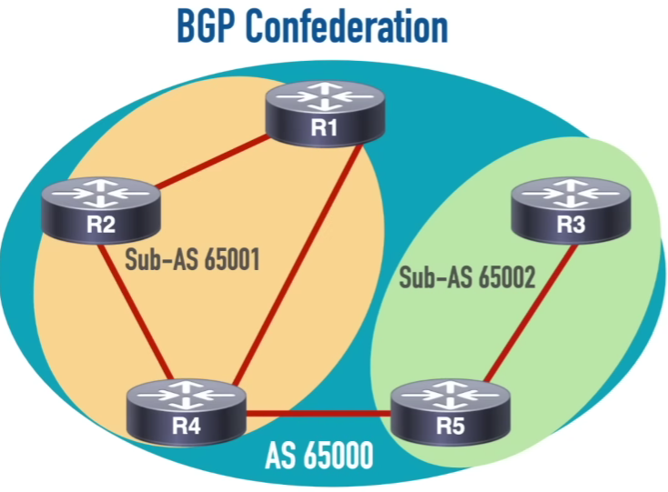
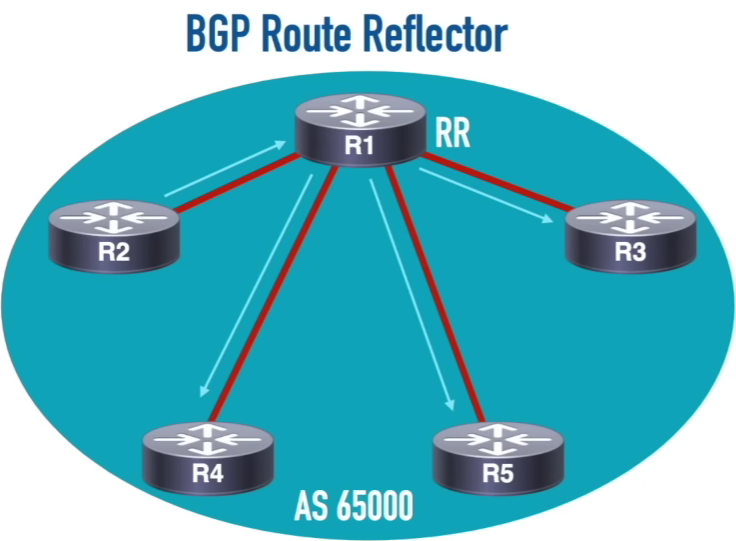
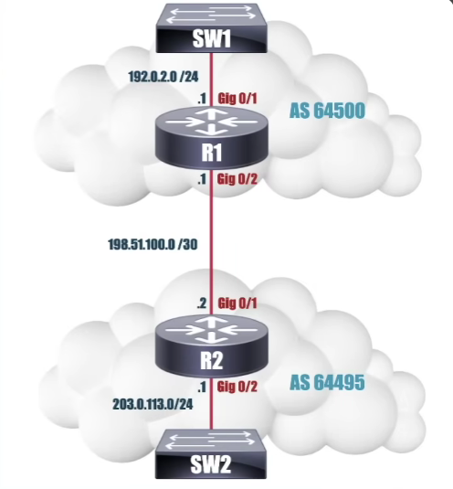

# Table of contents

- [Table of contents](#table-of-contents)
- [BGP Characteristics](#bgp-characteristics)
- [iBGP Full Mesh](#ibgp-full-mesh)
  - [What it is and its problem](#what-it-is-and-its-problem)
  - [BGP Confederation](#bgp-confederation)
  - [BGP Route Reflectors](#bgp-route-reflectors)
- [Neighbor Formation and States](#neighbor-formation-and-states)
  - [Neighbor Formation](#neighbor-formation)
  - [Messages After The Neighbor Formation](#messages-after-the-neighbor-formation)
  - [Verification Commands](#verification-commands)
- [BGP Basic Config](#bgp-basic-config)
- [Path Selection (WE LOVE ORANGES AS ORANGES MEAN PURE REFRESHMENT)](#path-selection-we-love-oranges-as-oranges-mean-pure-refreshment)
  - [8 Path Attributes](#8-path-attributes)
  - [Weight](#weight)
  - [Local Preference](#local-preference)
  - [Originate](#originate)
  - [AS Path Length](#as-path-length)
  - [Origin Type](#origin-type)
  - [Multi-exit Discriminator (MED)](#multi-exit-discriminator-med)
  - [Paths](#paths)
  - [Router ID](#router-id)
- [BGP Synchronization](#bgp-synchronization)


# BGP Characteristics

- Path Vector Protocol

  - BGP is called a path vector protocol because it advertises **the explicit sequence of Autonomous Systems** (known as the `AS_PATH` attribute) that a route has traveled through, rather than just a simple hop count or a distance metric

  - Instead of just saying “this destination is 3 hops away” (like distance-vector protocols), BGP passes along the exact list of AS numbers (e.g., AS 100 -> AS 200 -> AS 300) the update has crossed

- Routers form **neighborships**

    - Routers don't send `hello` packet to a multicast address like OSPF and EIGRP

    - The Neighbor IP is explicitly configured - **no dyanmic neighbor discover**

- A **TCP Port 179** Session is established between neighbors

- **NLRI** (Network Layer Reachability Information): router advertisement

    - It is the block of data that represents **a set of reachable IP prefixes** (or network destinations) **advertised between BGP peers**

    - `NLRI` entry typically consists of a prefix (the network address, such as `192.168.1.0` or `10.0.0.0`) and a length (the CIDR network mask, such as `/24` or `/8`). For example, `192.168.1.0/24 = NLRI`

    - How it is sent: `NLRIs` are carried inside BGP `UPDATE` messages. When a BGP router wants to tell its neighbors about a new network it can reach—or withdraw a network that went down—it includes the corresponding NLRI in an `Update` message

    - Path Attributes: An NLRI doesn't travel alone; it is bundled with a set of path attributes (such as `AS_PATH`, `NEXT_HOP`, and `LOCAL_PREF`) that describe how to get to that network and policies for choosing the best rout

- **Path Attributes**: BGP advertises a collection of Path Attributes used for Path Selection


# iBGP Full Mesh

## What it is and its problem



- An iBGP full mesh is a network design in which every internal BGP (iBGP) router within the same AS establishes a direct BGP peering session with every other iBGP router

- It has a Scaling Problem: `n(n-1)/2` -> 50 routers require 1,225 sessions

- Solutions: **BGP Route Reflectors** and **BGP Confederations**

## BGP Confederation



- Sub-AS Division: The large AS is broken down into smaller sub-ASes, typically assigned private AS numbers (ranging from 64,512 to 65,535)

- Routers inside the same sub-AS use standard **iBGP rules**

- **Connections between different sub-ASes** inside the confederation use confederation **eBGP** sessions. These sessions behave much like eBGP — retaining next-hop behavior and avoiding the iBGP full-mesh constraint — while preserving special attributes like the confederation sequence

## BGP Route Reflectors



- A BGP Route Reflector (RR) is a designated router in an Internal BGP (iBGP) network that redistributes (reflects) routing updates between iBGP peers


# Neighbor Formation and States

## Neighbor Formation

- Idle State

- 3-way TCP Handshake

- Active State

- Open Sent State: R1 to R2

- Open Confirm State: R2 to R1

- Established State

## Messages After The Neighbor Formation

- Open Message: includes BGP Version Number, Local AS Number, Hold Time, BGP Router ID, Optional Parameters

- Update Message: contain withdrawn routes, path attributes and NLRI

- Notification Message: contains an error code, an error subcode and information about the error

- Default Timers: Keepalive - 60 seconds, Holdtime 180 seconds

## Verification Commands

```bash
R2(config)# router bgp 64495
R2(config-router)# neighbor 198.51.100.1 remote-as 64500
R2(config-router)# network 203.0.113.0 mask 255.255.255.0
R2(config-router)# end
-----------------------------------------------------------------------------------------
R2# show ip bgp summary
-----------------------------------------------------------------------------------------
BGP router identifier 192.168.1.2, local AS number 64495
BGP table version is 4, main routing table version 4
2 network entries using 288 bytes of memory
2 path entries using 160 bytes of memory
2 BGP path attribute entries using 288 bytes of memory
BGP scan interval 60 secs, BGP holddown interval is 180 secs
Neighbor        V    AS MsgRcvd MsgSent   TblVer  InQ OutQ Up/State/PfxRcd
198.51.100.1    4  64500     142     145        4    0    0 02:15:30      1
192.168.2.1     4  64495       0       0        1    0    0    00:00:15  Active
10.10.10.2       4    65002   12500    12600    25      0    0     5d12h      150
10.10.10.3       4    65003   0        0         0      0    0     00:05:12   Idle
10.10.10.4       4    65004   0        0         0      0    0     00:02:30   Connect
10.10.10.6       4    65006   10       5         0      0    0     00:00:30   OpenSent
10.10.10.7       4    65007   15       10        0      0    0     00:00:45   OpenConfirm
10.10.10.8       4    65008   8500     8600      25     0    0     3d08h      200
10.10.10.9       4    65009   4500     4600      25     0    0     1d04h      75
```

- `V`: BGP version (always 4 for modern BGP)

- `Up/State/PfxRcd`: This is the most crucial column

  - Time (e.g., `02:15:30`) / Number (e.g., `1`): If the session is up and healthy, it shows how long the session has been **Established (uptime)** followed by the **number of prefixes** received from that neighbor

  - Active: The router is actively trying to initiate **a TCP connection to the peer** (TCP handshake failed or listener isn't up yet)


# BGP Basic Config



```bash
R2(config)# router bgp 64495
R2(config-router)# neighbor 198.51.100.1 remote-as 64500
R2(config-router)# network 203.0.113.0 mask 255.255.255.0
R2(config-router)# end
R2(config)# do show ip bgp
R2(config)# do show ip route
```

- These commands configure `eBGP`

- Why it's `eBGP`:

  - Different AS: The local router is configured in AS 64495, while the peer neighbor is in a completely different AS

  - `iBGP` Rule: For `iBGP`, both routers must belong to the same AS


# Path Selection (WE LOVE ORANGES AS ORANGES MEAN PURE REFRESHMENT)

```bash
Router# show ip bgp
BGP table version is 22, local router ID is 10.1.1.1
Status codes: s suppressed, d damped, h history, * valid, > best, i - internal, 
              r RIB-failure, S Stale, m multipath, b backup-path, x best-external
Origin codes: i - IGP, e - EGP, ? - incomplete

   Network          Next Hop            Metric LocPrf Weight Path
*> 10.1.1.1/32      0.0.0.0                  0         32768 i
* i10.2.2.2/32      172.16.1.2               0   100     0 i
*>i10.9.9.9/32      192.168.3.2              0   100     0 10 10 i
*>  172.16.1.0/24   0.0.0.0                  0         32768 i
* i                 172.16.1.2               0   100     0 i
*>  192.168.1.0     0.0.0.0                  0         32768 i
* i192.168.3.0      172.16.1.2               0   100     0 i
```

- The route with the next hop as `0.0.0.0` mean it is directly connected

- `>` means a preferred path

## 8 Path Attributes

- Weight

- Local preference

- Originate

- AS Path Length

- Origin Type

- Multi-exit Discriminator (MED)

- Paths

- Router ID

## Weight

- Cisco Proprietery

- A higher `Weight` is preffered

- Commonly used to influence **outbound** routing decisions

## Local Preference

- Carried throughout a single AS

- A higher `Local Preference` is preferred

- Commonly used to influence **outbound** routing decisions

## Originate

- Paths, which are sourced locally, are preferred

- A **locally originated path** refers to a route that was introduced into BGP directly by your own router or AS, rather than being learned from a remote peer via eBGP or iBGP

- How a Route Becomes **Locally Originated**

  - The `network` Command: You explicitly tell BGP to advertise a prefix using the network statement

  - Redistribution: You inject routes from an IGP like OSPF or EIGRP, or static routes, directly into BGP using the `redistribute` command

  - BGP Aggregation: You summarize multiple specific routes into a single summary prefix using the aggregate-address command

## AS Path Length

- The number of ASes in the AS_PATH path attribute

  - What the **AS_PATH path attribute** looks like in a BGP Table: `*> 10.0.0.0/24    192.168.1.1              0    0 65001 65002 65003 i`

  - `65001 65002 65003` is the `AS_PATH`

- Lower AS path lengths are preferred

- Commonly used to influence **inbound** routing decisions

## Origin Type

- Indicates how the route was injected into BGP: `i` (network command), `e` (EGP), `?` (redistributed)

- `i` is preferred to `e`, and `e` is preferred to `?`

## Multi-exit Discriminator (MED)

- A parameter **set and advertised by routers in one AS** to influence the BGP path selection decisions of **routers in another AS**

- A lower MED is preferred

## Paths

- Prefer eBGP path over iBGP path

## Router ID

- Most popular and most used if we don't manipulate everything

- The route received from the router with the lowest router ID is preferred


# BGP Synchronization

- BGP synchronization is **a legacy routing rule** stating that a BGP router must not advertise a prefix learned from an iBGP neighbor to an eBGP neighbor unless that same prefix is also present in the local IGP routing table (such as OSPF or EIGRP)

- Purpose and Context

  - Preventing Black Holes: It was designed for transit Autonomous Systems (AS) where not all internal routers run BGP. If a router learns a route via iBGP but intermediate routers inside the AS do not know the path via the IGP, packets crossing the AS could be dropped ("black-holed")

  - IGP Validation: The rule forces the AS to ensure internal reachability before external announcement

- Default State: Disabled by default (no synchronization) in modern Cisco IOS (since version 12.2(8)T) and other major network operating systems