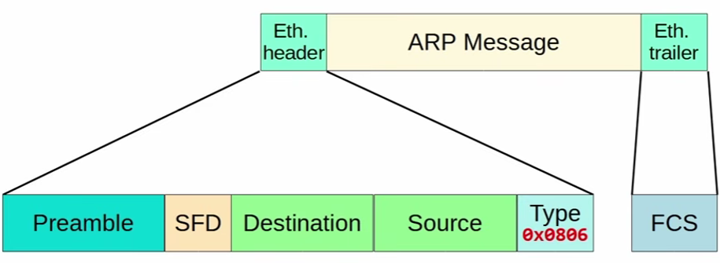

# Table of Contents

- [Table of Contents](#table-of-contents)
- [ARP Message Format](#arp-message-format)
- [Proxy ARP](#proxy-arp)
  - [What it is](#what-it-is)
  - [Configuration](#configuration)
  - [Use Case 1: Directly Connected Route (Interface-Based Static Route)](#use-case-1-directly-connected-route-interface-based-static-route)
  - [Use Case 2: Mismatched Subnet Mask](#use-case-2-mismatched-subnet-mask)
- [Gratuitous ARP](#gratuitous-arp)


# ARP Message Format

- ARP messages are encapsulated directly within an **Ethernet Header and Trailer**

    

- The `EtherType` (type field of the Ethernet header) will be `0x0806` to indicate ARP

- An **IPv4/Ethernet ARP** message is 28 bytes in length - ARP can be used for **various L2 & L3 protocols**


# Proxy ARP

## What it is

- Proxy ARP was originally defined in **RFC 1027**

- It allows a device (usually a router) to respond to ARP Requests for IP addresses that are not its own

- Modern use cases involve end hosts with incorrect subnet masks, 'directly connected' static routes, and some NAT scenarios

- Proxy ARP is enabled globally and on each router interface by default (in Cisco IOS)

## Configuration

```bash
# Disable/[Enable] proxy ARP globally 
R1(config)# [no] ip arp proxy disable
# Enable/[Disable] proxy ARP on an interface 
R1(config-if)# [no] ip proxy-arp
# Confirm proxy ARP status on an interface 
R1# show ip interface g0/0
    GigabitEthernet0/0 is up, line protocol is up Internet address is 192.168.1.1/24 Broadcast address is 255.255.255.255
    Proxy ARP is enabled
```

## Use Case 1: Directly Connected Route (Interface-Based Static Route)

- A **directly-connected static route** is a route in which you specify the **exit interface**, but **NOT the next-hop IP**: `ip route 192.168.34.0 255.255.255.0 G0/0`

    ```bash
    R1(config)# ip route 192.168.34.0 255.255.255.0 GigabitEthernet0/0 
    R1# show ip route
        192.168.12.0/24 is variably subnetted, 2 subnets, 2 masks 
        C   192.168.12.0/24 is directly connected, GigabitEthernet0/0 
        L   192.168.12.1/32 is directly connected, GigabitEthernet0/0 
        S 192.168.34.0/24 is directly connected, GigabitEthernet0/0     # this is the directly-connected static route
    ```

- The ARP Resolution Problem

    - Because the router views the destination as **directly connected**, it assumes the **Target IP** resides on that same local link (but the target is actually a **remote host**)

    - When a packet is sent to an IP in that range (`192.168.34.0 /24`), the router needs a Layer 2 MAC address to encapsulate the frame

    - **Instead of arping for a gateway IP** (send packet to the next hop), it **broadcasts an ARP request** for the actual Destination IP itself out of that interface

    - If Proxy ARP is enabled on the neighbor
    
        - it inspects its own routing table, 
        
        - recognizes that it has a valid route to reach that destination IP, 
        
        - and responds with its own MAC address on behalf of the remote host

## Use Case 2: Mismatched Subnet Mask

- Host A: `192.168.1.10 /24`

- Host B: `192.168.1.65 /26` (`192.168.1.64` to `192.168.1.127`) - the subnet mask SHOULD BE `/24`, NOT `/26`

- Router (Default Gateway): `192.168.1.1 /24`; Proxy ARP enabled

- Host A thinks Host B is in the same subnet, it broadcasts an ARP request onto the wire `Who has 192.168.1.65? Tell 192.168.1.10.`

- Host B receives the broadcast, and ignore it because its subnet mask is `/26` - it thinks Host A is out of range

- The Router hears Host A's ARP request. The router checks its own routing table and says:

    - I don't have `192.168.1.65` directly attached as a host route

    - But I know how to reach that IP address because it's in my **connected interface** network (`192.168.1.0/24`)

    - Since Host B isn't answering, I will answer for it

    - The router sends a **Gratuitous ARP** reply back to Host A: `I am 192.168.1.65, and here is my MAC address: aabb.cc00.1111.` (The router's own MAC address)

    - Host A caches the Router's MAC

    - When Host A sends its data packets to Host B, it encapsulates them with the Router's MAC address as the destination


# Gratuitous ARP

- It is an **ARP Reply WITHOUT receiving an ARP Request**: the **Destination MAC** is always `FF:FF:FF:FF:FF:FF:FF:FF`

- Its main purpose is to update the **ARP Table** of Switches and Hosts

- Usecases

    - Announcing when an interface is enabled

    - Announcing a change in MAC address

    - Failover between redundant devices like in `FHRP`