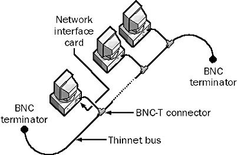
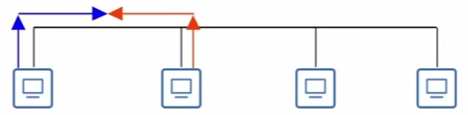
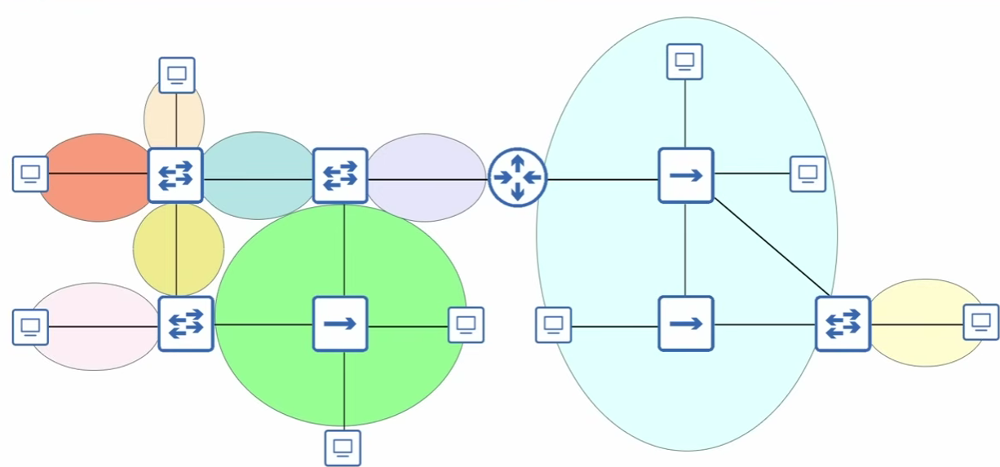

# OSI & TCP/IP

## OSI

- App, Presentation, Session, Transport, Network, Data Link, Physical

## TCP/IP

- App, Transport, Internet, Link

# Collision Domains

- Early networking technologies like `Thinnet (10BASE-2)` and `Thicknet (10BASE-5)` involved **connecting all devices to the same network cable** (`coaxial`)

    - **No Hubs Required:** Devices connected directly using BNC T-connectors plugged straight into the back of each computer's network card

        

    - Thinnet Ethernet Cable components: **Thinnet Ethernet Cable** + **BNC Connector**
    
    - Now we are using `UTP` cables: **RJ45 Connector** (different from BNC Connector of the Thinnet Cable)

- Disadvantages of the Thinnet Ethernet Cable

    - Signals sent over the cable are **received by all connected devices**

    - If 2 hosts talk to each other at the same time, **collision** occurs

        

    - Solutions: **CSMA/CD** - when devices detect collisions on the cable, each device waits, and transmit again

- **Half-duplex**: devices **can both send/receive data**, but **can't do both at the same time**

    - Duplex: a device can both send and receive

    - Half: the device can only do one at a time

- A **collision domain** is a network segment where **simultaneous data transmissions collides**

    - Example: when devices are connected using Thinnet, they are all in the same collision domain, only one device can transmit at a time

- A **Hub** is like the 10BASE network

    - If 2 devices, connected to a hub, send data at the same time, **hub repeats both signals at the same time => collision**

    - **All devices connected to a hub are in a collision domain** and must operate in half-duplex (+CSMA/CD)

    - **Every ports of a Hub are in the same collision domain**

- How a SW can replace a Hub

    - SWs are more intelligent than hubs, they are **Layer 2 aware** - knows where to send frames using MAC Table

    - Additionally, SWs have **the ability to buffer frames** before sending them

        - If a SW receives two broadcast frames at the same time, it will not flood both at the same time

        - One message will be buffered and transmitted only after the other one

        - **Devices connected to a SW are all in separate collision domains**. Devices can operate in **full-duplex** - 2 devices can send data at a time

    - **Every ports of a SW are in its own collision domain**

- Practice: there are 9 collision domains in this topology

    

# Broadcast Domain

- A broadcast domain is a logical division of a network in which **all nodes can reach each other by L2 broadcast**

- **All devices connected to a SW** are in the same broadcast domain

- Each router interface is a unique broadcast domain: routers don't forward L2 broadcast messages

# L2 Forwarding

- Although routers operate at L3, they are still L2 aware, because they must inspect the dest MAC of the packets they receive

    - and use L2 to address frames to the next hop

    - or check if the frame is for the router itself

- 4 message types from the L2 Forwarding:

    - Unicast (known): action - forward

    - Unicast (unknown): action - flood

    - Broadcast: action - flood

    - Multicast: action - flood