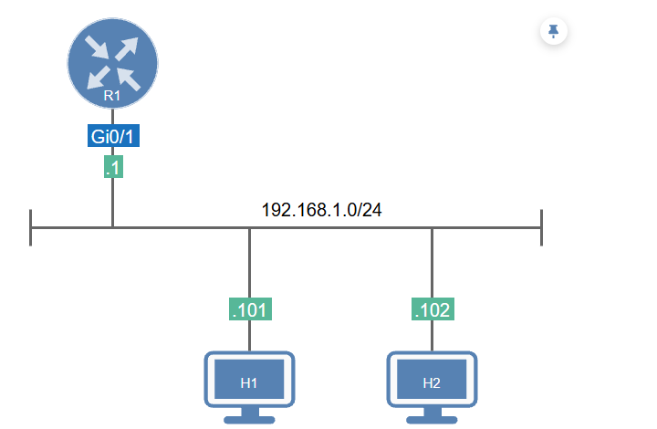

# IGMP

## IGMPv1

- It uses 2 messages: `Membership Report` and `Membership Query`

    - Hosts send a membership report to the group address to join

    - The router will periodically send a membership query to destination `224.0.0.1` (all hosts multicast group address)
    
        - Hosts that receive this message will respond with a membership report to tell the router that they are still interested in receiving the multicast traffic
        
        - When the router receives the membership report, its expiry timer will be refreshed

- Problem: hosts don't report router when they are no longer interested in multicast group. The router will keep forwarding multicast traffic to the hosts until the timer expires

    ```bash
    R1#show ip igmp groups 239.1.1.1
    IGMP Connected Group Membership
    Group Address    Interface                Uptime    Expires   Last Reporter   Group Accounted
    239.1.1.1        GigabitEthernet0/1       19:22:56  00:01:07  192.168.1.101
    ```

- Configuration

    

    ```bash
    # configure R1
    R1(config)#ip multicast-routing
    R1(config)#interface GigabitEthernet 0/1
    R1(config-if)#ip igmp version 1
    R1(config-if)#ip pim sparse-mode

    # configure host
    H1(config)#interface GigabitEthernet 0/1
    H1(config-if)#ip igmp version 1
    H1(config-if)#ip igmp join-group 239.1.1.1
    ```

## IGMPv2

- In IGMPv1, hosts stop listening to the multicast group address without reporting to the router

- New features of IGMPv2

    - Leave group messages: when a host no longer wants to listen to a multicast group address then it will report to the router that it has stopped listening

    - Group-specific membership query: When the router receives a leave group message, it will send this query to check if there are still any hosts interested in receiving the multicast traffic

    - MRT (Maximum Response Time) field: a new field in query messages. It specifies how much time hosts have to respond to the query

    - Querier election process: when there are two routers in the same subnet, then only one of them should send query messages

- Report Suppression: a mechanism where hosts listening to the same multicast group cancel their own membership report if they hear another host report for that group first

    - A multicast router sends a membership query to the subnet, including a MRT field

    - Each host subscribed to a multicast group sets a random delay timer up to the MRT

    - The host whose timer expires first sends a Membership Report to the multicast group address

    - Other hosts on the same segment receive this report while their timers are still running, stop their timers, and stay silent

    - The router only needs confirmation that at least one active member remains on the subnet to keep forwarding multicast traffic for that group

- The Leave Mechanism

    ```bash
    # R2 leaves the multicast group
    H2(config)#interface GigabitEthernet 0/1
    H2(config-if)#no ip igmp join-group 239.1.1.1

    # R1 receives the leave msg of H2 (.102), sends a query to the group, receives response from H1 (.101)
    R1#
    IGMP(0): Received Leave from 192.168.1.102 (GigabitEthernet0/1) for 239.1.1.1
    IGMP(0): Send v2 Query on GigabitEthernet0/1 for group 239.1.1.1
    IGMP(0): Received v2 Report on GigabitEthernet0/1 from 192.168.1.101 for 239.1.1.1

    # H1 leaves the multicast group
    H1(config)#interface GigabitEthernet 0/1
    H1(config-if)#no ip igmp join-group 239.1.1.1
    H1#
    IGMP(0): IGMP delete group 239.1.1.1 on GigabitEthernet0/1
    IGMP(0): Send Leave for 239.1.1.1 on GigabitEthernet0/1

    # R1 receives the leave msg of H1 (.101), sends a query to the group, receives no responses, deletes the group from the multicast routing table
    R1#
    IGMP(0): Received Leave from 192.168.1.101 (GigabitEthernet0/1) for 239.1.1.1
    IGMP(0): Send v2 Query on GigabitEthernet0/1 for group 239.1.1.1
    IGMP(0): MRT delete GigabitEthernet0/1 for (*,239.1.1.1) by 0
    ```

## IGMPv3

- IGMP version 3 adds support for **source filtering**

- Each group a host joins also has a `mode`

    - Include: this is a list of source addresses that we accept multicast traffic from

    - Exclude: this is a list of source addresses that we refuse to accept multicast traffic from

    - Example

        ```bash
        R1#show ip igmp groups 239.1.1.1 detail
        Interface:      GigabitEthernet0/1
        Group:          239.1.1.1
        Flags:
        Uptime:         00:12:27
        Group mode:     INCLUDE
        Last reporter:  192.168.1.101
        Group source list: (C - Cisco Src Report, U - URD, R - Remote, S - Static,
                            V - Virtual, M - SSM Mapping, L - Local,
                            Ac - Channel accounted towards access control limit)
        Source Address   Uptime    v3 Exp   CSR Exp   Fwd  Flags
        1.1.1.1          00:12:27  00:02:27  stopped   Yes  R
        ```

- The router **maintains multicast membership information per host** and can account for different source-filtering requirements

    - Suppose two hosts want to receive traffic for multicast group `239.1.1.1`
    
    - Host A wants traffic from all sources EXCEPT `Source 10.1.1.5`, host B wants all traffic INCLUDING `Source 10.1.1.5`

    - The router maintains separate membership records for each host, rather than applying one source filter to the entire multicast group

- The destination of the `membership report` is `224.0.0.22`, NOT the group address like IGMPv1 and IGMPv2

    - For example, a host wants to join multicast group `239.1.1.1`

    - The host sends to the destination IP `224.0.0.22`, and the group record is `239.1.1.1`

    - It is `239.1.1.1` for IGMPv1 and IGMPv2

- Configuration

    ```bash
    H1(config)#interface GigabitEthernet 0/1
    H1(config-if)#ip igmp version 3
    H1(config-if)#ip igmp join-group 239.1.1.1 source 1.1.1.1

    H1#
    IGMP(0): WAVL Insert group: 239.1.1.1 interface: GigabitEthernet0/1 Successful
    IGMP(0): Create source 1.1.1.1
    IGMP(0): Building v3 Report on GigabitEthernet0/1
    IGMP(0): Add Group Record for 239.1.1.1, type 5
    IGMP(0): Send unsolicited v3 Report with 1 group records on GigabitEthernet0/1
    IGMP(0): Building v3 Report on GigabitEthernet0/1
    IGMP(0): Add Group Record for 239.1.1.1, type 5
    IGMP(0): Send unsolicited v3 Report with 1 group records on GigabitEthernet0/1
    ```

## IGMP Filter

- Configure IGMP filtering on a multicast router to restrict the multicast group addresses

- Router IGMP Filter Config

    ```bash
    R1(config)#ip access-list standard LIMIT_IGMP
    R1(config-std-nacl)#deny host 239.2.2.2
    R1(config-std-nacl)#permit 224.0.0.0 15.255.255.255
    R1(config)#interface GigabitEthernet 0/1
    R1(config-if)#ip pim sparse-mode
    R1(config-if)#ip igmp access-group LIMIT_IGMP

    H1(config)#interface GigabitEthernet 0/1
    H1(config-if)#ip igmp join-group 239.2.2.2

    R1#
    IGMP(0): Received v2 Report on GigabitEthernet0/1 from 192.168.1.1 for 239.2.2.2
    IGMP(*): Group 239.2.2.2 access denied on GigabitEthernet0/1
    ```

- Switch IGMP Snooping Filter Config

    ```bash
    # block multicast group 239.3.3.3
    SW1(config)#ip igmp profile 1
    SW1(config-igmp-profile)#deny
    SW1(config-igmp-profile)#range 239.3.3.3
    SW1(config)#interface GigabitEthernet 1/0/2
    # the "ip igmp filter" command is what we need to activate the IGMP profile. You can only activate this on l2 access ports
    SW1(config-if)#ip igmp filter 1
    ```


# Multicast Layer 2

## Verification Commands

```bash
# IGMP is enabled on a switch
SW1#show ip igmp snooping | include snoop 
IGMP snooping                : Enabled

# check the multicast router
SW1#show ip igmp snooping querier 
Vlan      IP Address               IGMP Version   Port             
-------------------------------------------------------------
1         192.168.1.254            v2            Fa0/1 

# debug
SW1#debug ip igmp snooping 239.1.1.1
IGMPSN: group: Received IGMPv2 report for group 239.1.1.1 received on Vlan 1, port Fa0/3
IGMPSN: Add v2 group 239.1.1.1 member port Fa0/3, on Vlan 1
IGMPSN: group: Added port Fa0/3 to group 239.1.1.1
IGMPSN: group: Forwarding 239.1.1.1 report to router ports
```

## IGMP Snooping

- For IPv4 multicast, **the multicast MAC address** range is: `01:00:5E:00:00:00` through `01:00:5E:7F:FF:FF`

    - Multiple IPv4 multicast addresses can map to the same Ethernet multicast MAC address

    - The Layer 2 switch may see the same multicast MAC for different multicast IP groups

- IGMP Snooping is a L2 switch feature

- IGMP Snooping allows us to constrain our multicast traffic by **listening to IGMP traffic** between the router and hosts **on the same VLAN**

    - When the host sends a `membership report` (IGMP Packet) for a multicast group then the switch adds **an entry in the CAM table** for the interface that is connected to the host
    
    - When the host sends a `leave message` (IGMP Packet) for a multicast group then the switch removes **an entry in the CAM table** for the interface that is connected to the host

    - Problems

        - For IGMPv1, hosts never send any leave group messages so there’s nothing to snoop

        - A video server that never joins any multicast groups but only streams traffic to it => no IGMP to snoop

- How a SW detect the interfaces connected to **multicast enabled routers**

    - A multicast-enabled VLAN **needs an active IGMP Querier**. The querier is commonly a Layer 3 switch or router
    
    - Once IGMP snooping is enabled, the switch will detect multicast enabled routers by listening to the following messages

        - IGMP General Query (0100.5e00.0001)

        - OSPF (0100.5e00.0005 and 0100.5e00.0006)

        - PIM version 1 and HSRP (0100.5e00.0002)

        - PIM version 2 (0100.5e00.000d)

        - DVMRP (0100.5e00.0004)

    - When the switch detects a **multicast enabled router** then it will add the corresponding entry in the MAC table

    - For example, all multicast traffic that has destination MAC address `0100.5e01.0101` will only be forwarded on interfaces connected to **multicast enabled router**

- Configuration

    ```bash
    # how switch learns the location of the multicast-enabled router
    SW1#debug ip igmp snooping router
    router debugging is on
    R1(config)#ip multicast-routing 
    R1(config)#interface GigabitEthernet 0/1
    R1(config-if)#ip pim sparse-mode
    SW1#
    IGMPSN: router: PIMV2 Hello packet received in 1
    IGMPSN: router: Learning port: Gi1/0/1 as rport on Vlan 1
    IGMPSN: router: Received IGMP pak on Vlan 1, port Gi1/0/1
    SW1#show ip igmp snooping querier 
    Vlan      IP Address               IGMP Version  Port              
    -------------------------------------------------------------
    1         192.168.1.254            v2            Gi1/0/1
    SW1#show ip igmp snooping mrouter
    Vlan    ports
    ----    -----
    1    Gi1/0/1(dynamic)

    # configure H1 to join a multicast group
    SW1#debug ip igmp snooping 239.1.1.1
    group IP address debugging is on for 239.1.1.1
    H1(config)#interface GigabitEthernet 0/1
    H1(config-if)#ip igmp join-group 239.1.1.1
    SW1#
    IGMPSN: Received IGMPv2 Report for group 239.1.1.1 received on Vlan 1, port Gi1/0/2
    IGMPSN: Add v2 group 239.1.1.1 member port Gi1/0/2, on Vlan 1
    L2MM: Add member: gda:0100.5e01.0101, adding Gi1/0/2
    IGMPSN: group: Added port Gi1/0/2 to group 239.1.1.1
    IGMPSN: group: Forwarding 239.1.1.1 report to router ports
    SW1#show ip igmp snooping groups 
    Flags: I -- IGMP snooping, S -- Static, E -- EVPN sync
    Vlan      Group                    Type        Version     Port List
    -----------------------------------------------------------------------
    1         224.0.1.40               I           v2          Gi1/0/1
    1         239.1.1.1                I           v2          Gi1/0/2

    # configure H2 to join a multicast group
    H2(config)#interface GigabitEthernet 0/1
    H2(config-if)#ip igmp join-group 239.1.1.1
    SW1#
    IGMPSN: Received IGMPv2 Report for group 239.1.1.1 received on Vlan 1, port Gi1/0/3
    IGMPSN: Add v2 group 239.1.1.1 member port Gi1/0/3, on Vlan 1
    IGMPSN: group: Added port Gi1/0/3 to group 239.1.1.1
    IGMPSN: group: Forwarding 239.1.1.1 report to router ports
    SW1#show ip igmp snooping groups 
    Flags: I -- IGMP snooping, S -- Static, E -- EVPN sync
    Vlan      Group                    Type        Version     Port List
    -----------------------------------------------------------------------
    1         224.0.1.40               I           v2          Gi1/0/1
    1         239.1.1.1                I           v2          Gi1/0/2, Gi1/0/3

    # the hosts should see each other’s membership reports but this is not the case anymore
    # both hosts are now sending membership reports because they don’t see each other’s messages
    debug ip igmp 
    IGMP debugging is on
    H1#
    IGMP(0): Received v2 Query on GigabitEthernet0/1 from 192.168.1.254
    IGMP(0): Set report delay time to 5.6 seconds for 239.1.1.1 on GigabitEthernet0/1
    IGMP(0): Send v2 Report for 239.1.1.1 on GigabitEthernet0/1
    H2#
    IGMP(0): Received v2 Query on GigabitEthernet0/1 from 192.168.1.254
    IGMP(0): Set report delay time to 2.8 seconds for 239.1.1.1 on GigabitEthernet0/1
    IGMP(0): Send v2 Report for 239.1.1.1 on GigabitEthernet0/1

    # one host leaves the group
    SW1#debug ip igmp snooping group
    group debugging is on
    H2(config)#interface Gigabit0/1
    H2(config-if)#no ip igmp join-group 239.1.1.1
    SW1#
    IGMPSN: Received IGMP Leave for group 239.1.1.1 received on Vlan 1, port Gi1/0/3
    IGMPSN: group: Group exist - Leave for group 239.1.1.1 Client 192.168.1.2 received on Vlan 1, port Gi1/0/3, group state (1)
    IGMPSN: group: Created v2 leave port on port Gi1/0/3, for group 239.1.1.1 on Vlan 1 
    IGMPSN: group: Sending Group- Specific Query for group 239.1.1.1 on Vlan 1, port Gi1/0/3
    IGMPSN: group: Sending Group- Specific Query for group 239.1.1.1 on Vlan 1, port Gi1/0/3
    IGMPSN: group: Deleting leave port on port Gi1/0/3, for 239.1.1.1 on Vlan 1 
    IGMPSN: group: Deleting port Gi1/0/3 from group 239.1.1.1 on Vlan 1
    ```