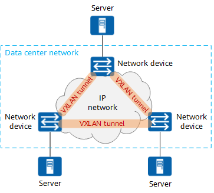
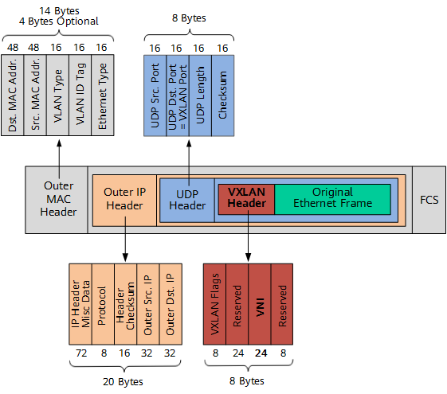
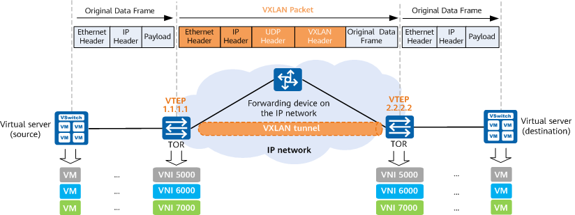
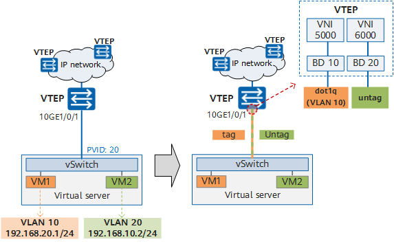

# Table of contents

- [Table of contents](#table-of-contents)
- [What VXLAN is](#what-vxlan-is)
- [Why VXLAN Required](#why-vxlan-required)
  - [VMs need to be dynamically migrated](#vms-need-to-be-dynamically-migrated)
  - [Sharply Increasing Tenants in the Data Center Require Isolation](#sharply-increasing-tenants-in-the-data-center-require-isolation)
- [VXLAN Encapsulation](#vxlan-encapsulation)
- [VTEPs and VNIs in VXLAN](#vteps-and-vnis-in-vxlan)
  - [What VTEP is](#what-vtep-is)
  - [What VNI is](#what-vni-is)
  - [BD and VNI Mapping](#bd-and-vni-mapping)
- [How a VXLAN Tunnel is established](#how-a-vxlan-tunnel-is-established)
  - [Manually Establishing a VXLAN Tunnel](#manually-establishing-a-vxlan-tunnel)
  - [Automatically Establishing a VXLAN Tunnel](#automatically-establishing-a-vxlan-tunnel)
  - [Which Tunnel Should Packets Enter?](#which-tunnel-should-packets-enter)


# What VXLAN is

- Virtual eXtensible Local Area Network (`VXLAN`) is one of the Network Virtualization over Layer 3 (`NVO3`) technologies

- VXLAN **encapsulates a L2 Ethernet Frame into a UDP packet** and transmits the packet over **a L3 network**

- VXLAN is essentially **a tunneling technology**

    

    - It establishes **a logical tunnel on the IP network** between the **source and destination network devices** to encapsulate user-side packets and forward them through the tunnel

    - **Servers are connected to different ports** of network devices in the VXLAN network


# Why VXLAN Required

- This is closely related to the virtualization trend on the server side of **the data center**

## VMs need to be dynamically migrated

- The data center wants to **move VM1 from Server A to Server B** without any interruptions

- After the VM migration, the VMs can still work **without a need to changes its IP Address**

- How VXLAN helps

    - **Traditional VLANs** have a limitation: they are generally confined to a Layer 2 network domain, and extending Layer 2 connectivity across a large data center can be difficult

    - **VXLAN allows Layer 2 networks to be extended over a Layer 3 IP network using encapsulation**

    - Example: Server A and Server B are connected through a Layer 3 IP network

    - VM1 runs on Server A, VM1 belongs to VXLAN 100 (identified by its VNI), VM1 migrates to Server B, Server B can provide access to the same VXLAN 100

    - As a result, VM1 can retain its logical Layer 2 network connectivity even though its physical location has changed

## Sharply Increasing Tenants in the Data Center Require Isolation

- Traditional VLANs provide only 4,094 usable VLAN IDs (12 bits), which can become a limitation

    - Data Centers have thousands or millions of VMs for customers

- VXLAN provides approximately 16 million possible VNIs (24 bits), allowing many more isolated virtual networks


# VXLAN Encapsulation



- A VXLAN tunnel endpoint (VTEP) encapsulates the following headers **into the original Ethernet frame (original L2 frame)**

- VXLAN Header (8 bytes): includes a 24-bit VNI field for defining different tenants on the VXLAN network

- UDP Header

    - The **destination port number** (VXLAN Port) is fixed at 4789

    - The **source port number** (UDP Src. Port) is calculated using the hash algorithm based on the original Ethernet frame

- Outer IP Header

    - The source IP address (Outer Src. IP) is the IP address of the VTEP connected to the source VM
    
    - The destination IP address (Outer Dst. IP) is the IP address of the VTEP connected to the destination VM

- Outer MAC Header

    - The source MAC address (Src. MAC Addr.) is the MAC address of the VTEP connected to the source VM
    
    - The destination MAC address (Dst. MAC Addr.) is the MAC address of the next hop along the path to the destination VTEP


# VTEPs and VNIs in VXLAN



## What VTEP is

- A `VTEP` is an edge device on a VXLAN network

- It is the **start or end point of a VXLAN tunnel**, which **encapsulates and decapsulates** original user data frames respectively

- A `VTEP` can be **an independent network device** (such as a Huawei CloudEngine series switch) or **a virtual switch** deployed on a server

## What VNI is

- The number of VLAN IDs is limited at 4,094. `VNI` is specifically to solve this problem

- It is a user identifier **similar to a VLAN ID**

- It is used to **identify isolated L2 or L3 virtual network segments** over a shared physical IP network

- In **distributed gateway deployment** scenarios, VNIs can be classified into Layer 2 VNIs and Layer 3 VNIs

## BD and VNI Mapping

- "The large Layer 2 domain" is similar to the VLAN on a traditional network. On a VXLAN network, it is called **bridge domain (BD)**

    - Different VLANs are identified by VLAN IDs

    - Different BDs are identified by VNIs

- `1:1 Mapping` Rule: one BD can be mapped to only one VNI

    ```bash
    bridge-domain 10   //Create BD 10.
     vxlan vni 5000  //Bind VNI 5000 to BD 10.
    #
    <HUAWEI> display vxlan vni
    Number of vxlan vni : 1 
    VNI            BD-ID            State  
    --------------------------------------- 
    5000           10               up 
    ```

- Which **BDs** do packets belong to? (`only Huawei devices`)

    

    - **VTEP is one function of a switch**. This means that **not all the packets that enter the switch will go through a VXLAN tunnel**. It is possible that some packets are forwarded according to the common Layer 2 and Layer 3 forwarding processes. Before determining which BDs packets belong to, we need to know which packets will enter a VXLAN tunnel

    - On Huawei CloudEngine series switches, they use logical L2 **sub-interfaces**, instead of physical interfaces

    - These interfaces provide two functions: One is to check which packets need to enter a VXLAN tunnel based on configuration, and the other is to determine how to process the packets that are allowed to pass through

    - To determine which BDs packets belong to, we need to add Layer 2 sub-interfaces to specified BDs

    - Config Example

        ```bash
        interface 10GE1/0/1.1 mode l2   //Create Layer 2 sub-interface 10GE1/0/1.1.
            encapsulation dot1q vid 10   //Configure 10GE1/0/1.1 to allow only packets with VLAN tag 10 to enter a VXLAN tunnel.
            bridge-domain 10   //Add 10GE1/0/1.1 to BD 10.
        #
        interface 10GE1/0/1.2 mode l2   //Create Layer 2 sub-interface 10GE1/0/1.2.
            encapsulation untag   //Configure 10GE1/0/1.2 to allow only packets without VLAN tags to enter a VXLAN tunnel.
            bridge-domain 20   //Add 10GE1/0/1.2 to BD 20.
        #
        ```


# How a VXLAN Tunnel is established

## Manually Establishing a VXLAN Tunnel

```bash
interface Nve1   //Create logical interface NVE 1.
 source 1.1.1.1   //Configure the IP address of the source VTEP. The IP address of a loopback interface is recommended here.
 vni 5000 head-end peer-list 2.2.2.2   
 vni 5000 head-end peer-list 2.2.2.3   
```

- The config is performed on a Network Virtualization Edge (NVE) interface

- In the configurations of `vni 5000 head-end peer-list 2.2.2.2` and `vni 5000 head-end peer-list 2.2.2.3`, there are **two remote VTEPs** that belong to **VNI 5000**, and their IP addresses are `2.2.2.2` and `2.2.2.3` respectively

```bash
<HUAWEI> display vxlan vni 5000 verbose
    BD ID                 : 10 
    State                  : up 
    NVE                    : 288
    Source Address      : 1.1.1.1
    Source IPv6 Address    : -
    UDP Port               : 4789 
    BUM Mode               : head-end
    Group Address          : -  
    Peer List            : 2.2.2.2 2.2.2.3  
    IPv6 Peer List         : -
```

- According to the `Peer List` field, the local VTEP can determine which remote VTEPs belong to the same BD (or same VNI)

- When the VTEP receives **broadcast, unknown unicast, and multicast (BUM) packets**, it replicates the packets and sends them to the remote VTEPs in the peer list (this is like broadcasting packets within a VLAN)

- When the VTEP receives **known unicast packets**, it determines the VXLAN tunnel that the packets will go through based on the local MAC address table

## Automatically Establishing a VXLAN Tunnel

- Automatic VXLAN tunnel establishment depends on Ethernet virtual private network (EVPN)

## Which Tunnel Should Packets Enter?

- There may be more than one VXLAN tunnel that belongs to the same BD. For example, in the mentioned ingress replication list, the source VTEP (`1.1.1.1`) has two remote VTEPs (`2.2.2.2` and `2.2.2.3`). So another question arises: which tunnel are packets supposed to enter?

- In **basic Layer 2 and Layer 3 forwarding**, Layer 2 forwarding relies on the MAC address table and Layer 3 forwarding relies on the Forwarding Information Base (FIB) table. If there is no required MAC address entry, a host broadcasts an ARP request packet to obtain the remote MAC address. This implementation is similar on a VXLAN network