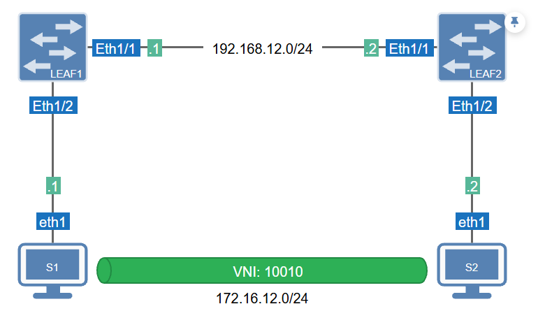
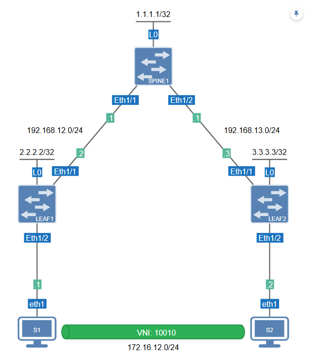

# Table of contents

- [Table of contents](#table-of-contents)
- [Overlay Network](#overlay-network)
  - [Underlay Network vs Overlay Network](#underlay-network-vs-overlay-network)
  - [Overlay Networking Technologies](#overlay-networking-technologies)
- [VXLAN Introduction](#vxlan-introduction)
  - [Key Takeaways](#key-takeaways)
  - [VNI (VXLAN Network Identifier)](#vni-vxlan-network-identifier)
  - [VTEP (VXLAN Tunnel Endpoint - VXLAN Gateway)](#vtep-vxlan-tunnel-endpoint---vxlan-gateway)
  - [Control Plane](#control-plane)
- [Manually Configuring Remote VXLAN VTEP](#manually-configuring-remote-vxlan-vtep)
  - [Configuration](#configuration)
- [VXLAN Flood and Learn Multicast Data Plane](#vxlan-flood-and-learn-multicast-data-plane)
  - [How multicast works in VXLAN Flood and Learn](#how-multicast-works-in-vxlan-flood-and-learn)
  - [Step-by-step example: Host A communicates with Host B](#step-by-step-example-host-a-communicates-with-host-b)
  - [Topology](#topology)
  - [Configuration](#configuration-1)
  - [Verification](#verification)


# Overlay Network

## Underlay Network vs Overlay Network

- The **underlay network** is typically **a L3 Routed Fabric** with **Routing Protocols** such as OSPF, IS-IS, or BGP

    - Its only purpose is to be a transport network for the overlay network

    - The underlay network also requires an increased MTU because of encapsulation overhead

- The **overlay network** is the virtual (logical) network that is built on top of the underlay network

    - This is usually done using tunneling
    
    - Overlay networks can provide Layer 2 (bridging) or Layer 3 (routing) services over the underlay network

## Overlay Networking Technologies

- VLAN

- GRE

- VPN

- DMVPN

- VXLAN

- LISP

- SD-WAN


# VXLAN Introduction

## Key Takeaways

- VXLAN uses a **24-bit VNI** (VXLAN Network Identifier), allowing **~16 million VXLANs**

- VTEP devices (VXLAN Tunnel Endpoints) **encapsulate and de-encapsulate L2 traffic**, available as **software (hypervisor-based)** or **hardware (switch/router-based)**

- L3 Underlay Network **eliminates spanning tree**, enabling **ECMP load balancing** on redundant links

- Four control plane options: Static unicast, multicast flood-and-learn, MP-BGP EVPN, and VXLAN with LISP

- **UDP port 4789** is the official VXLAN port

## VNI (VXLAN Network Identifier)

- It **identifies the VXLAN** and has a similar function as the VLAN ID for regular VLANs

## VTEP (VXLAN Tunnel Endpoint - VXLAN Gateway)

- It is the device that’s responsible for encapsulating and de-encapsulating layer 2 traffic

- The VTEP comes in two forms: **Software (host-based)** and **Hardware (gateway)**

    - Software: Hypervisors like VMWare’s ESXi or Microsoft’s Hyper-V. These hypervisors use **virtual switches**, and some of them support VXLAN

    - Hardware
    
        - A **Router, Switch, or Firewall** which supports VXLAN

        - We also call a hardware VTEP a **VXLAN Gateway** because it combines a regular VLAN and VXLAN segment into a single layer 2 domain
        
        - Some switches have VXLAN support with ASICs, offering better VXLAN performance than a software VTEP

- Each VTEP has two interfaces types

    - VTEP IP Interface: connects the VTEP to the underlay network with **a unique IP address** (loopback interface). This interface **encapsulates and de-encapsulates** Ethernet frames

    - VNI Interface: a virtual interface that keeps network traffic separated on the physical interface. Similar to an SVI interface

    - A VTEP can have multiple VNI interfaces, but they associate with the same VTEP IP interface

    - Example

        

## Control Plane

- Each VTEP has a **VXLAN mapping (forwarding) table** that **maps a destination MAC address to a remote VTEP IP address**

- The control plane helps VTEP devices learn MAC addresses

- 4 control plane solutions

    - VXLAN with static unicast VXLAN tunnels

    - VXLAN with multicast underlay

    - VXLAN with MP-BGP EVPN (a popular choice in data centers)

    - VXLAN with LISP (a popular choice for campus networks)


# Manually Configuring Remote VXLAN VTEP

- It is called **VXLAN Static Ingress Replication**. It uses a **flood and learn mechanism** on the **data plane**

- Each VTEP **replicates** incoming broadcast, unknown-unicast, and multicast (BUM) traffic to all configured VTEPs

## Configuration



- Topology

    - 2 SWs connected to each other with a **L3 link**
    
    - 2 Servers are connected to **L2 interfaces** and use **IP addresses in the same subnet**. They **won’t be able to communicate** with each other until we configure VXLAN

- Underlay Network

    - Each leaf switch requires a loopback interface with an IP address that we’ll use for the VTEP addresses

    - An IGP to advertise the loopback interfaces

    - Config

        ```bash
        LEAF1(config)#interface Ethernet 1/1
        LEAF1(config-if)#no switchport
        LEAF1(config-if)#mac-address 0050.c253.1001
        LEAF1(config-if)#ip address 192.168.12.1/24
        LEAF1(config)#interface Loopback 0
        LEAF1(config-if)#ip address 1.1.1.1/32

        LEAF2(config)#interface Ethernet 1/1
        LEAF2(config-if)#no switchport
        LEAF2(config-if)#mac-address 0050.c253.2001
        LEAF2(config-if)#ip address 192.168.12.2/24
        LEAF2(config)#interface Loopback 0
        LEAF2(config-if)#ip address 2.2.2.2/32

        # LEAF1 & LEAF2
        (config)#feature ospf
        (config)#router ospf 1
        (config)#interface Ethernet 1/1
        (config-if)#ip ospf network point-to-point
        (config-if)#ip router ospf 1 area 0.0.0.0
        (config)#interface Loopback 0
        (config-if)#ip router ospf 1 area 0.0.0.0
        ```

- Overlay Network: VNI and NVE (Network Virtual Interface)

    ```bash
    # VNI LEAF1
    LEAF1#(config)#feature vn-segment-vlan-based
    LEAF1(config)#vlan 10
    LEAF1(config-vlan)#vn-segment 10010
    LEAF1(config)#interface Ethernet 1/2
    LEAF1(config-if)#switchport access vlan 10
    # VNI LEAF2
    LEAF2#(config)#feature vn-segment-vlan-based
    LEAF2(config)#vlan 10
    LEAF2(config-vlan)#vn-segment 10010
    LEAF2(config)#interface Ethernet 1/2
    LEAF2(config-if)#switchport access vlan 10

    # NVE LEAF1
    LEAF1(config)#feature nv overlay
    LEAF1(config)#interface nve 1
    LEAF1(config-if-nve)#no shutdown
    LEAF1(config-if-nve)#source-interface Loopback 0
    LEAF1(config-if-nve)#member vni 10010
    LEAF1(config-if-nve-vni)#ingress-replication protocol static
    LEAF1(config-if-nve-vni-ingr-rep)#peer-ip 2.2.2.2
    # NVE LEAF2
    LEAF2(config)#feature nv overlay
    LEAF2(config)#interface nve 1
    LEAF2(config-if-nve)#no shutdown
    LEAF2(config-if-nve)#source-interface Loopback 0
    LEAF2(config-if-nve)#member vni 10010
    LEAF2(config-if-nve-vni)#ingress-replication protocol static
    LEAF2(config-if-nve-vni-ingr-rep)#peer-ip 1.1.1.1
    ```

- Verification

    ```bash
    LEAF1# show vxlan
    Vlan            VN-Segment
    ====            ==========
    10              10010

    LEAF1# show nve peers
    Interface Peer-IP                                 State LearnType Uptime   Router-Mac       
    --------- --------------------------------------  ----- --------- -------- -----------------
    nve1      2.2.2.2                                 Up    DP        00:10:12 n/a

    LEAF1# show nve peers detail
    Details of nve Peers:
    ----------------------------------------
    Peer-Ip: 2.2.2.2
        NVE Interface       : nve1
        Peer State          : Up
        Peer Uptime         : 00:10:33
        Router-Mac          : n/a
        Peer First VNI      : 10010
        Time since Create   : 00:10:33
        Configured VNIs     : 10010
        Provision State     : peer-add-complete
        Learnt CP VNIs      : 10010
        vni assignment mode : SYMMETRIC
        Peer Location       : N/A

    LEAF1# show nve vni
    Codes: CP - Control Plane        DP - Data Plane
        UC - Unconfigured         SA - Suppress ARP
        SU - Suppress Unknown Unicast 
        Xconn - Crossconnect      
        MS-IR - Multisite Ingress Replication 
        HYB - Hybrid IRB mode
        
    Interface VNI      Multicast-group   State Mode Type [BD/VRF]      Flags
    --------- -------- ----------------- ----- ---- ------------------ -----
    nve1      10010    UnicastStatic     Up    DP   L2 [10]
    ```

    - DP means data plane


# VXLAN Flood and Learn Multicast Data Plane

## How multicast works in VXLAN Flood and Learn

- Each VTEP is configured with a multicast group for its VNI

- The VTEPs join the multicast group using IGMP

- The underlay multicast network uses IGMP snooping and PIM (typically PIM Sparse Mode) to establish multicast distribution

- **When a VTEP needs to flood BUM traffic**, it encapsulates the Ethernet frame into VXLAN

- The encapsulated packet is sent to the multicast group address

- The multicast network replicates the packet and delivers it to the other VTEPs that joined the group

## Step-by-step example: Host A communicates with Host B

- Assume Host A wants to communicate with Host B, but VTEP 1 doesn't know Host B's MAC address

- Host A sends an ARP request: Source MAC is `MAC-A`, Destination MAC is `FF:FF:FF:FF:FF:FF`

- VTEP 1 receives this Ethernet frame and encapsulates the original Ethernet frame inside VXLAN

- The outer packet looks like this

    - Outer Ethernet header: Underlay source/destination MAC

    - Outer IP header: source IP is `VTEP 1 IP`, destination IP is `239.1.1.10`

    - UDP Header: Destination port 4789

    - VXLAN Header: VNI 10010

    - Original Ethernet frame: ARP broadcast from Host A

- The underlay network forwards the multicast packet to all participating VTEPs (VTEP2 and VTEP3)

    - When VTEPs receive VXLAN-encapsulated traffic, they learn the source MAC address and its associated remote VTEP IP address

    - Example: VTEP2 learns MAC-A is in VTEP1's IP

- VTEP2 and VTEP3 check the VNI, forward the frame into the corresponding local Layer 2 segment

- Host B receives the ARP request and responds (unicast)

- Subsequent communication uses unicast

## Topology



## Configuration

    ```bash
    # underlay network: SPINE1
    SPINE1(config)#interface Ethernet 1/1
    SPINE1(config-if)#no switchport
    SPINE1(config-if)#mac-address 0050.c253.1001
    SPINE1(config-if)#ip address 192.168.12.1/24
    SPINE1(config-if)#no shutdown
    SPINE1(config)#interface Ethernet 1/2
    SPINE1(config-if)#no switchport
    SPINE1(config-if)#mac-address 0050.c253.1002
    SPINE1(config-if)#ip address 192.168.13.1/24
    SPINE1(config-if)#no shutdown
    SPINE1(config)#interface Loopback 0
    SPINE1(config-if)#ip address 1.1.1.1/32
    # underlay network: LEAF1
    LEAF1(config)#interface Ethernet 1/1
    LEAF1(config-if)#no switchport
    LEAF1(config-if)#mac-address 0050.c253.2001
    LEAF1(config-if)#ip address 192.168.12.2/24
    LEAF1(config-if)#no shutdown
    LEAF1(config-if)#exit
    LEAF1(config)#interface Loopback 0
    LEAF1(config-if)#ip address 2.2.2.2/32
    # underlay network: LEAF2
    LEAF2(config)#interface Ethernet 1/1
    LEAF2(config-if)#no switchport
    LEAF2(config-if)#mac-address 0050.c253.3001
    LEAF2(config-if)#ip address 192.168.13.3/24
    LEAF2(config-if)#no shutdown
    LEAF2(config)#interface Loopback 0
    LEAF2(config-if)#ip address 3.3.3.3/32
    # underlay network - ospf
    (config)#feature ospf # SPINE1, LEAF1 & LEAF2
    (config)#router ospf 1
    SPINE1(config)#interface Ethernet 1/1 - 2
    SPINE1(config-if-range)#ip ospf network point-to-point
    SPINE1(config-if-range)#ip router ospf 1 area 0.0.0.0
    SPINE1(config)#interface Loopback 0
    SPINE1(config-if)#ip router ospf 1 area 0.0.0.0
    (config-router)#interface Ethernet 1/1 # LEAF1 & LEAF2
    (config-if)#ip ospf network point-to-point
    (config-if)#ip router ospf 1 area 0.0.0.0
    (config)#interface Loopback 0
    (config-if)#ip router ospf 1 area 0.0.0.0

    # multicast: enable multicast
    SPINE1(config)#feature pim
    SPINE1(config)#ip pim rp-address 1.1.1.1
    # multicast: enable PIM on all interfaces
    SPINE1(config)#interface Ethernet 1/1 - 2
    SPINE1(config-if-range)#ip pim sparse-mode
    SPINE1(config)#interface Loopback 0
    SPINE1(config-if)#ip pim sparse-mode
    # multicast: leaf switches (LEAF1 & LEAF2)
    (config)#feature pim
    (config)#ip pim rp-address 1.1.1.1
    (config)#interface Ethernet 1/1
    (config-if)#ip pim sparse-mode
    (config)#interface Loopback 0
    (config-if)#ip pim sparse-mode

    # overlay network: vni (LEAF1 & LEAF2)
    (config)#feature vn-segment-vlan-based
    (config)#vlan 10
    (config-vlan)#vn-segment 10010
    (config)#interface Ethernet 1/2
    (config-if)#switchport access vlan 10
    # overlay network: nve (LEAF1 & LEAF2)
    (config)#feature nv overlay
    (config)#interface nve1
    (config-if-nve)#no shutdown
    (config-if-nve)#source-interface loopback0
    (config-if-nve)#member vni 10010
    (config-if-nve-vni)#mcast-group 239.1.1.1
    ```

## Verification

    ```bash
    # multicast: the spine switch sees two PIM neighbors
    SPINE1# show ip pim neighbor
    PIM Neighbor Status for VRF "default"
    Neighbor        Interface            Uptime    Expires   DR       Bidir-  BFD    ECMP Redirect
                                                            Priority Capable State     Capable
    192.168.12.2    Ethernet1/1          00:17:43  00:01:26  1        yes     n/a     no
    192.168.13.3    Ethernet1/2          00:17:43  00:01:31  1        yes     n/a     no
    # multicast: the leaf switches see SPINE1 as the RP
    LEAF1# show ip pim rp
    PIM RP Status Information for VRF "default"
    BSR disabled
    Auto-RP disabled
    BSR RP Candidate policy: None
    BSR RP policy: None
    Auto-RP Announce policy: None
    Auto-RP Discovery policy: None
    RP: 1.1.1.1, (0), 
    uptime: 00:57:59   priority: 255, 
    RP-source: (local),  
    group ranges:
    224.0.0.0/4
    # multicast routing table of SPINE1
    SPINE1# show ip mroute 239.1.1.1
    (*, 239.1.1.1/32), uptime: 00:01:40, pim ip 
    Incoming interface: loopback0, RPF nbr: 1.1.1.1
    Outgoing interface list: (count: 2)
        Ethernet1/2, uptime: 00:01:00, pim
        Ethernet1/1, uptime: 00:01:40, pim
    (2.2.2.2/32, 239.1.1.1/32), uptime: 00:01:29, pim mrib ip 
    Incoming interface: Ethernet1/1, RPF nbr: 192.168.12.2, internal
    Outgoing interface list: (count: 1)
        Ethernet1/2, uptime: 00:01:00, pim
    (3.3.3.3/32, 239.1.1.1/32), uptime: 00:00:32, pim mrib ip 
    Incoming interface: Ethernet1/2, RPF nbr: 192.168.13.3, internal
    Outgoing interface list: (count: 1)
        Ethernet1/1, uptime: 00:00:32, pim
    # multicast routing table of LEAF1
    LEAF1# show ip mroute 239.1.1.1
    (*, 239.1.1.1/32), uptime: 00:15:18, nve ip pim 
    Incoming interface: Ethernet1/1, RPF nbr: 192.168.12.1
    Outgoing interface list: (count: 1)
        nve1, uptime: 00:15:18, nve
    (2.2.2.2/32, 239.1.1.1/32), uptime: 00:15:18, nve mrib ip pim 
    Incoming interface: loopback0, RPF nbr: 2.2.2.2
    Outgoing interface list: (count: 1)
        Ethernet1/1, uptime: 00:14:26, pim

    # nve interface: using VNI 10010 and multicast group 239.1.1.1
    LEAF1(config-if-nve)#show nve vni
    Interface VNI      Multicast-group   State Mode Type [BD/VRF]      Flags
    --------- -------- ----------------- ----- ---- ------------------ -----
    nve1      10010    239.1.1.1         Up    DP   L2 [10]

    # the two leaf switches don’t know about each other yet
    LEAF1(config-if-nve)#show nve peer
    LEAF2(config-if-nve)#show nve peer

    # ping from S1 to S2: the ping should work, the VXLAN Tunnel is formed between the Leaf Switches
    LEAF1# show nve peer
    Interface Peer-IP                                 State LearnType Uptime   Router-Mac       
    --------- --------------------------------------  ----- --------- -------- -----------------
    nve1      3.3.3.3                                 Up    DP        00:01:42 n/a
    # the two leaf switches learned about each other as NVE peers, let’s check the MAC address tables
    LEAF1# show mac address-table dynamic
    VLAN     MAC Address      Type      age     Secure NTFY Ports
    ---------+-----------------+--------+---------+------+----+------------------
    *   10     0050.c253.4001   dynamic  NA         F      F    Eth1/2
    *   10     0050.c253.5001   dynamic  NA         F      F    nve1(3.3.3.3)
    ```