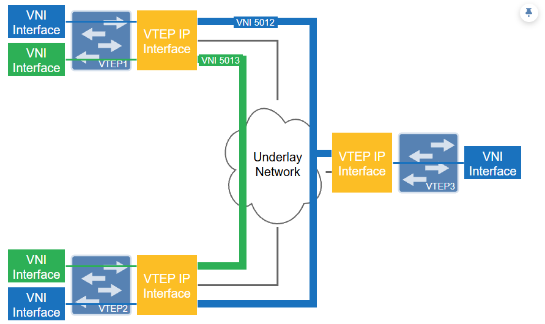

# Table of contents

- [Table of contents](#table-of-contents)
- [Overlay Network](#overlay-network)
  - [Underlay Network vs Overlay Network](#underlay-network-vs-overlay-network)
  - [Overlay Networking Technologies](#overlay-networking-technologies)
- [VXLAN Introduction](#vxlan-introduction)
  - [Key Takeaways](#key-takeaways)
  - [VNI (VXLAN Network Identifier)](#vni-vxlan-network-identifier)
  - [VTEP (VXLAN Tunnel Endpoint - VXLAN Gateway)](#vtep-vxlan-tunnel-endpoint---vxlan-gateway)
  - [Control Plane](#control-plane)
- [Manually Configuring Remote VXLAN VTEP](#manually-configuring-remote-vxlan-vtep)
  - [Configuration](#configuration)


# Overlay Network

## Underlay Network vs Overlay Network

- The **underlay network** is typically **a L3 Routed Fabric** with **Routing Protocols** such as OSPF, IS-IS, or BGP

    - Its only purpose is to be a transport network for the overlay network

    - The underlay network also requires an increased MTU because of encapsulation overhead

- The **overlay network** is the virtual (logical) network that is built on top of the underlay network

    - This is usually done using tunneling
    
    - Overlay networks can provide Layer 2 (bridging) or Layer 3 (routing) services over the underlay network

## Overlay Networking Technologies

- VLAN

- GRE

- VPN

- DMVPN

- VXLAN

- LISP

- SD-WAN


# VXLAN Introduction

## Key Takeaways

- VXLAN uses a **24-bit VNI** (VXLAN Network Identifier), allowing **~16 million VXLANs**

- VTEP devices (VXLAN Tunnel Endpoints) **encapsulate and de-encapsulate L2 traffic**, available as **software (hypervisor-based)** or **hardware (switch/router-based)**

- L3 Underlay Network **eliminates spanning tree**, enabling **ECMP load balancing** on redundant links

- Four control plane options: Static unicast, multicast flood-and-learn, MP-BGP EVPN, and VXLAN with LISP

- **UDP port 4789** is the official VXLAN port

## VNI (VXLAN Network Identifier)

- It **identifies the VXLAN** and has a similar function as the VLAN ID for regular VLANs

## VTEP (VXLAN Tunnel Endpoint - VXLAN Gateway)

- It is the device that’s responsible for encapsulating and de-encapsulating layer 2 traffic

- The VTEP comes in two forms: **Software (host-based)** and **Hardware (gateway)**

    - Software: Hypervisors like VMWare’s ESXi or Microsoft’s Hyper-V. These hypervisors use **virtual switches**, and some of them support VXLAN

    - Hardware
    
        - A **Router, Switch, or Firewall** which supports VXLAN

        - We also call a hardware VTEP a **VXLAN Gateway** because it combines a regular VLAN and VXLAN segment into a single layer 2 domain
        
        - Some switches have VXLAN support with ASICs, offering better VXLAN performance than a software VTEP

- Each VTEP has two interfaces types

    - VTEP IP Interface: connects the VTEP to the underlay network with **a unique IP address** (loopback interface). This interface **encapsulates and de-encapsulates** Ethernet frames

    - VNI Interface: a virtual interface that keeps network traffic separated on the physical interface. Similar to an SVI interface

    - A VTEP can have multiple VNI interfaces, but they associate with the same VTEP IP interface

    - Example

        

## Control Plane

- Each VTEP has a **VXLAN mapping (forwarding) table** that **maps a destination MAC address to a remote VTEP IP address**

- The control plane helps VTEP devices learn MAC addresses

- 4 control plane solutions

    - VXLAN with static unicast VXLAN tunnels

    - VXLAN with multicast underlay

    - VXLAN with MP-BGP EVPN (a popular choice in data centers)

    - VXLAN with LISP (a popular choice for campus networks)


# Manually Configuring Remote VXLAN VTEP

- It is called **VXLAN Static Ingress Replication**. It uses a **flood and learn mechanism** on the **data plane**

- Each VTEP **replicates** incoming broadcast, unknown-unicast, and multicast (BUM) traffic to all configured VTEPs

## Configuration


- Topology

    - 2 SWs connected to each other with a **L3 link**
    
    - 2 Servers are connected to **L2 interfaces** and use **IP addresses in the same subnet**. They **won’t be able to communicate** with each other until we configure VXLAN

- Underlay Network

    - Each leaf switch requires a loopback interface with an IP address that we’ll use for the VTEP addresses

    - An IGP to advertise the loopback interfaces

    - Config

        ```bash
        LEAF1(config)#interface Ethernet 1/1
        LEAF1(config-if)#no switchport
        LEAF1(config-if)#mac-address 0050.c253.1001
        LEAF1(config-if)#ip address 192.168.12.1/24
        LEAF1(config)#interface Loopback 0
        LEAF1(config-if)#ip address 1.1.1.1/32

        LEAF2(config)#interface Ethernet 1/1
        LEAF2(config-if)#no switchport
        LEAF2(config-if)#mac-address 0050.c253.2001
        LEAF2(config-if)#ip address 192.168.12.2/24
        LEAF2(config)#interface Loopback 0
        LEAF2(config-if)#ip address 2.2.2.2/32

        # LEAF1 & LEAF2
        (config)#feature ospf
        (config)#router ospf 1
        (config)#interface Ethernet 1/1
        (config-if)#ip ospf network point-to-point
        (config-if)#ip router ospf 1 area 0.0.0.0
        (config)#interface Loopback 0
        (config-if)#ip router ospf 1 area 0.0.0.0
        ```

- Overlay Network: VNI and NVE (Network Virtual Interface)

    ```bash
    # VNI LEAF1
    LEAF1#(config)#feature vn-segment-vlan-based
    LEAF1(config)#vlan 10
    LEAF1(config-vlan)#vn-segment 10010
    LEAF1(config)#interface Ethernet 1/2
    LEAF1(config-if)#switchport access vlan 10
    # VNI LEAF2
    LEAF2#(config)#feature vn-segment-vlan-based
    LEAF2(config)#vlan 10
    LEAF2(config-vlan)#vn-segment 10010
    LEAF2(config)#interface Ethernet 1/2
    LEAF2(config-if)#switchport access vlan 10

    # NVE LEAF1
    LEAF1(config)#feature nv overlay
    LEAF1(config)#interface nve 1
    LEAF1(config-if-nve)#no shutdown
    LEAF1(config-if-nve)#source-interface Loopback 0
    LEAF1(config-if-nve)#member vni 10010
    LEAF1(config-if-nve-vni)#ingress-replication protocol static
    LEAF1(config-if-nve-vni-ingr-rep)#peer-ip 2.2.2.2
    # NVE LEAF2
    LEAF2(config)#feature nv overlay
    LEAF2(config)#interface nve 1
    LEAF2(config-if-nve)#no shutdown
    LEAF2(config-if-nve)#source-interface Loopback 0
    LEAF2(config-if-nve)#member vni 10010
    LEAF2(config-if-nve-vni)#ingress-replication protocol static
    LEAF2(config-if-nve-vni-ingr-rep)#peer-ip 1.1.1.1
    ```

- Verification

    ```bash
    LEAF1# show vxlan
    Vlan            VN-Segment
    ====            ==========
    10              10010

    LEAF1# show nve peers
    Interface Peer-IP                                 State LearnType Uptime   Router-Mac       
    --------- --------------------------------------  ----- --------- -------- -----------------
    nve1      2.2.2.2                                 Up    DP        00:10:12 n/a

    LEAF1# show nve peers detail
    Details of nve Peers:
    ----------------------------------------
    Peer-Ip: 2.2.2.2
        NVE Interface       : nve1
        Peer State          : Up
        Peer Uptime         : 00:10:33
        Router-Mac          : n/a
        Peer First VNI      : 10010
        Time since Create   : 00:10:33
        Configured VNIs     : 10010
        Provision State     : peer-add-complete
        Learnt CP VNIs      : 10010
        vni assignment mode : SYMMETRIC
        Peer Location       : N/A

    LEAF1# show nve vni
    Codes: CP - Control Plane        DP - Data Plane
        UC - Unconfigured         SA - Suppress ARP
        SU - Suppress Unknown Unicast 
        Xconn - Crossconnect      
        MS-IR - Multisite Ingress Replication 
        HYB - Hybrid IRB mode
        
    Interface VNI      Multicast-group   State Mode Type [BD/VRF]      Flags
    --------- -------- ----------------- ----- ---- ------------------ -----
    nve1      10010    UnicastStatic     Up    DP   L2 [10]
    ```

    - DP means data plane